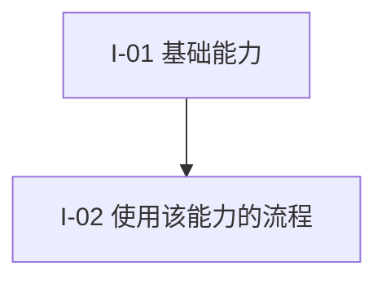

# Issue 依赖图：<项目名>

## 图谱元数据

- Goal: [[goal.md]] (`<GOAL-SLUG>` / baseline `1`)
- 仓库：`<owner/repo>`
- 最后核对 GitHub：`<时间或 not-synced>`
- 依赖事实源：下方 Issue 表；Mermaid 图只作展示。

## 节点与依赖

| Local ID | GitHub Issue | 标题/职责 | Goal IDs | Blocked by | Wave | 并行组 | 文件所有权 | 状态 |
| --- | --- | --- | --- | --- | --- | --- | --- | --- |
| I-01 | 草稿 / `#N` | `<一个可独立验收职责>` | G-01 | — | 1 | P1 / 串行 | `src/module-a/**` | `draft` |
| I-02 | 草稿 / `#N` | `<一个可独立验收职责>` | G-02 | I-01 | 2 | P2 / 串行 | `src/module-b/**` | `draft` |

### 依赖类型

- `blocked_by`：实现前置，必须等待该 Issue 达到约定完成状态。
- `related`：信息关联，不阻塞实施；放备注中，不画成依赖边。
- `parallel_group`：仅表示候选分组；启动并行前仍须确认文件范围隔离、接口冻结、测试数据隔离和独立工作树。

## 依赖关系图

## Goal 覆盖

| Goal 验收 ID | Issue / 项目级验收 | 状态 |
| --- | --- | --- |
| G-01 | I-01 | `mapped` |
| G-02 | I-02 | `mapped` |

## 图谱检查结果

- 唯一节点 ID：`<pass/fail>`
- 缺失节点引用：`<none/list>`
- 环检测：`<pass/fail>`
- 未映射 Goal ID：`<none/list>`
- 路径/接口冲突：`<none/list>`
- 可安全并行的节点及依据：`<none/list>`
- 当前已解锁节点：`<由实时状态核对后列出>`

## 本地图与 GitHub 同步记录

| 时间 | 节点 | 本地依赖 | GitHub 依赖读回 | 结果/原因 |
| --- | --- | --- | --- | --- |
| `<时间>` | I-01 | 无 | 不适用 | `draft` |
