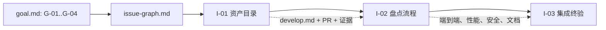

# 贯通示例：内部资产盘点工具

本示例只演示材料如何互相引用，不代表真实项目已经验证。性能数字和安全授权在真实项目中必须由用户确认；不得复制示例数字当作默认阈值。

## 文件

- [[goal.md]]：初始目标和 `G-*` 验收条件。
- [[issue-graph.md]]：`I-01 → I-02 → I-03` 的依赖关系。
- [[issues/I-01/develop.md]]：单 Issue 开发计划与证据记录。
- [[issues/I-02/develop.md]]：受前置依赖阻塞的消费端 Issue。
- [[issues/I-03/develop.md]]：所有功能合并后执行的终验与文档工作。

## 贯通关系

## 示例状态

所有 issue 编号、URL、命令、提交 SHA 和测试结果都是格式演示值。新项目使用前必须按真实仓库和 GitHub 状态替换，并读回远端校验。
