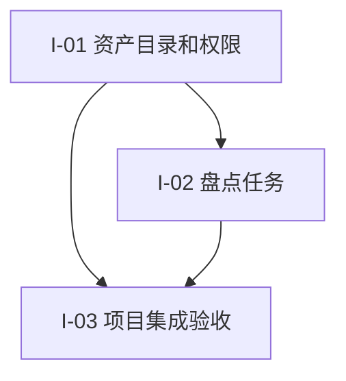

# Issue 依赖图：内部资产盘点工具（示例）

## 图谱元数据

- Goal：[[goal.md]] (`asset-inventory` / baseline `1`)
- 仓库：`example-org/asset-inventory`（示例）
- 最后核对 GitHub：`not-synced`（示例未连接远端）
- 依赖事实源：本表；Mermaid 只作展示。

## 节点与依赖

| Local ID | GitHub Issue | 标题/职责 | Goal IDs | Blocked by | Wave | 并行组 | 文件所有权 | 状态 |
| --- | --- | --- | --- | --- | --- | --- | --- | --- |
| I-01 | 草稿 / 示例 #101 | 建立资产目录查询与权限边界 | G-01 | — | 1 | P1 / 串行 | `src/assets/catalog/**` | `draft` |
| I-02 | 草稿 / 示例 #102 | 实现盘点任务创建和结果追踪 | G-02 | I-01 | 2 | P2 / 串行 | `src/inventory/**` | `draft` |
| I-03 | 草稿 / 示例 #103 | 完成集成验收、性能/安全验证和文档收敛 | G-01, G-02, G-03, G-04 | I-01, I-02 | 3 | P3 / 串行 | `tests/e2e/**`, `docs/**` | `draft` |

## 依赖关系图

## Goal 覆盖

| Goal 验收 ID | Issue / 项目级验收 | 状态 |
| --- | --- | --- |
| G-01 | I-01、I-03 | `mapped` |
| G-02 | I-02、I-03 | `mapped` |
| G-03 | I-03 | `mapped; threshold pending` |
| G-04 | I-03 | `mapped; authorization pending` |

## 图谱检查结果

- 唯一节点 ID：pass。
- 缺失节点引用：none。
- 环检测：pass。
- 未映射 Goal ID：none。
- 路径/接口冲突：开发时复核。
- 可安全并行的节点及依据：当前无；I-02 依赖 I-01，终验依赖全部功能实现。
- 当前已解锁节点：I-01（仅在真实 Issue 和仓库状态确认后）。

## 本地图与 GitHub 同步记录

| 时间 | 节点 | 本地依赖 | GitHub 依赖读回 | 结果/原因 |
| --- | --- | --- | --- | --- |
| 2026-11-24 | I-01..I-03 | 如表 | not-synced | 纯示例，禁止当作远端事实 |
